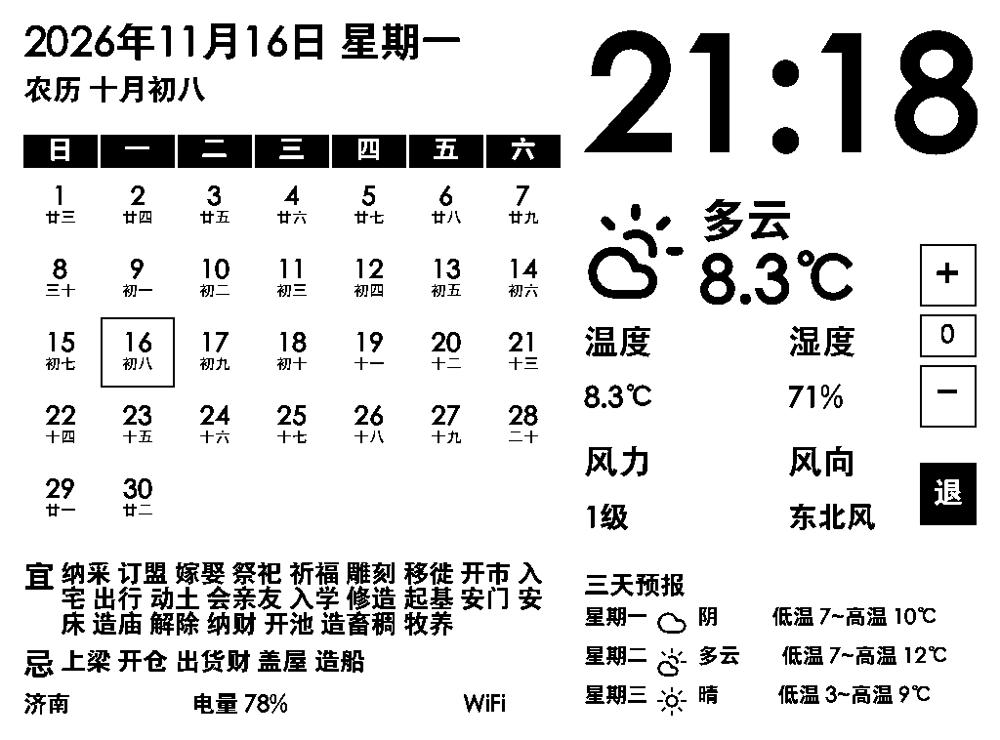

# Kindle 天气时钟

把闲置的 Kindle Paperwhite 2 改造成墨水屏天气时钟。

一屏显示日期、农历、当月日历、黄历宜忌、时钟、实时天气和三日预报；右侧有亮度调节和退出按钮，退出即回到原生书库。



## 特性

- **纯本地渲染**：Rust + Slint 软件渲染，直接写 framebuffer，不依赖浏览器/网络运行时
- **开箱即用**：数据全部来自公开 HTTP 接口，不需要 Home Assistant 或任何自建服务
- **省电**：设备平时可完全离线，取数时按需开关 WiFi；系统 WiFi 状态被保留，不会强制改动
- **干净的退出**：点「退」画好全屏提示后停掉框架，再恢复书库，不会在屏幕上闪状态栏
- **KUAL 集成**：装好后在 KUAL 菜单里一键启动

## 技术栈

- **Rust** + **Slint 1.17**（软件渲染器）
- 自研 [`slint-backend-kindle`](crates/slint-backend-kindle) 后端：framebuffer 写入、内部旋转、触摸转置、退出时唤醒系统框架
- 交叉编译到 `armv7-unknown-linux-musleabihf`（静态链接，不依赖 Kindle 上的 glibc）

## 安装

### 方式一：MRPI 安装包（推荐）

需要设备已越狱并装有 KUAL + MRPI。

1. 从 [Releases](../../releases) 下载 `update-kwc.bin`（或按下方「打包」自行生成）
2. 拷贝到 Kindle 的 `/mnt/us/mrpackages/`
3. 打开 KUAL → **Install MR Packages**
4. 安装完成后，KUAL 菜单里会出现 **Weather Clock → Start Weather Clock**

> MRPI 要求 `/mnt/us` 剩余空间 ≥ 150 MB，空间不足时会直接跳过安装。

### 方式二：手动部署

```bash
# 1. 主程序
scp target/armv7-unknown-linux-musleabihf/release/kindle-weather-clock root@<kindle-ip>:/mnt/us/kindle-weather-clock

# 2. 守护脚本
scp tools/run-kwc.sh root@<kindle-ip>:/mnt/us/run-kwc.sh

# 3. KUAL 扩展（注意：多数设备的 KUAL 扫描根是 /mnt/us/extensions）
ssh root@<kindle-ip> '
  mkdir -p /mnt/us/extensions/kwc/bin
  chmod 755 /mnt/us/kindle-weather-clock /mnt/us/run-kwc.sh
'
scp tools/extensions/kwc/config.xml tools/extensions/kwc/menu.json root@<kindle-ip>:/mnt/us/extensions/kwc/
scp tools/extensions/kwc/bin/kwc.sh root@<kindle-ip>:/mnt/us/extensions/kwc/bin/
ssh root@<kindle-ip> 'chmod 755 /mnt/us/extensions/kwc/bin/kwc.sh; rm -f /var/tmp/KUAL.cache'
```

详细的部署细节与踩坑记录见 [docs/DESIGN.md §9](docs/DESIGN.md)。

## 从源码构建

需要 Rust 工具链、`cargo-zigbuild` 和 `zig`（用于 musl 交叉链接）：

```bash
export PATH=$PWD/../.toolchain/zig-aarch64-macos-0.14.1:$PWD/../.toolchain/cargo/bin:$PATH
export HOME=$PWD/../.toolchain            # 让 cargo-zigbuild 的缓存目录落在工作区内
export CARGO_HOME=$PWD/../.toolchain/cargo
export RUSTUP_HOME=$PWD/../.toolchain/rustup

cargo zigbuild --release --target armv7-unknown-linux-musleabihf
```

产物：`target/armv7-unknown-linux-musleabihf/release/kindle-weather-clock`（约 19 MB）。

## 打包 MRPI 安装包

需要 [kindletool](https://github.com/NiLuJe/KindleTool)：

```bash
KINDLETOOL=/path/to/kindletool tools/build-mrpi.sh
# 或已把 kindletool 放进 PATH：tools/build-mrpi.sh
```

生成 `update-kwc.bin`（顶层只有 `install.sh` 一个脚本，守护脚本放在 `payload/` 子目录，避免被 MRPI 当成安装脚本执行）。

## 仓库结构

```
app/                          Slint 应用（main.rs + ui/app.slint）
crates/slint-backend-kindle/  Kindle 平台后端：framebuffer / 触摸 / 唤醒
assets/                       界面用字库与图标
tools/
  run-kwc.sh                  设备上的守护循环（崩溃自动重启、退出恢复 UI）
  build-mrpi.sh               本地打包 MRPI 安装包
  mrpi/install.sh             MRPI 安装脚本（包里唯一的顶层 .sh）
  extensions/kwc/             KUAL 扩展（config.xml / menu.json / bin/kwc.sh）
docs/DESIGN.md                完整设计文档
```

## 环境变量

| 变量 | 值 | 作用 |
|---|---|---|
| `KWC_SCALE` | `1` | 强制满屏 |
| `KWC_ROTATE` | `270` | 内部旋转方向 |

## 许可证

MIT OR Apache-2.0。框架层 `crates/slint-backend-kindle` 源自 [slint-kindle-backend](https://github.com/sverrejb/slint-kindle-backend)。
